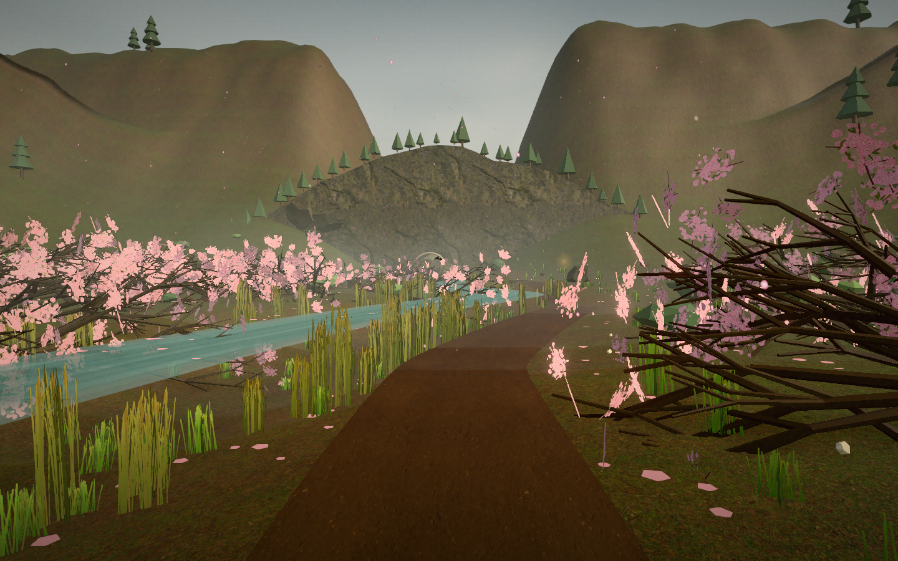
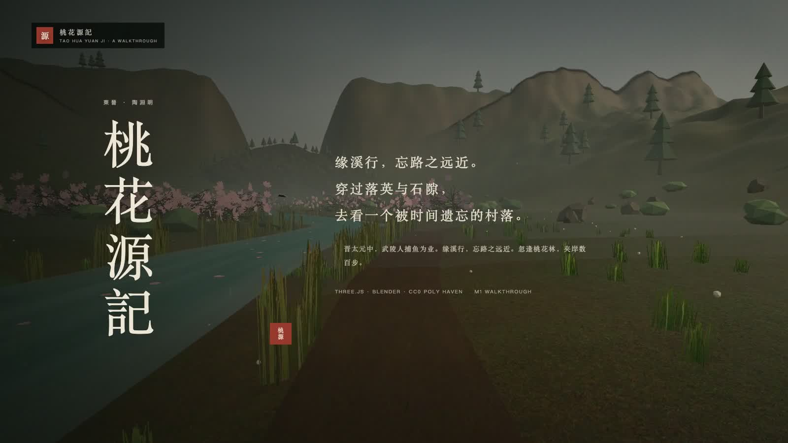

# 桃花源記 · 可漫游的世外桃源

一个以陶渊明《桃花源记》为叙事蓝本、用 **Three.js** 构建的第一人称可漫游三维场景。

**在线体验：** https://dannykkg.github.io/tao-hua-yuan-3d/  
**仓库：** https://github.com/dannykkg/tao-hua-yuan-3d  
**漫游演示：** [观看 92 秒视频](https://github.com/dannykkg/tao-hua-yuan-3d/releases/tag/m1)  
**M1 验收：** [M1_ACCEPTANCE.md](M1_ACCEPTANCE.md)

从武陵溪出发，沿溪穿过桃花林，进入山腹石隙；再走出洞口，看到良田、美池、桑竹、屋舍与往来种作的村人。你可以自由行走，也可以交由自动导览，依次经过原文的十二折。场景中的建筑、农事、器物与服饰参考汉晋之间的物质文化作了合理想象；这些补充以及相关争论，都收在「史注」里。



## 漫游演示

[](https://github.com/dannykkg/tao-hua-yuan-3d/releases/tag/m1)

约 92 秒，按原文次序剪成八段：溪口、桃花林、山口、洞中、洞口、村落、宴席、美池。中文标题与字幕，配环境声；画面取自实际场景漫游。

## 运行

```bash
npm install
npm run dev
```

打开终端提示的本地地址（默认 `http://127.0.0.1:5173`）。当前开发预览也可通过 `http://127.0.0.1:4173` 访问。

生产构建：

```bash
npm run build
npm run preview
```

建议使用支持 WebGL2 的桌面浏览器。移动端提供摇杆与拖拽环顾。

## 操作

| 操作 | 说明 |
| --- | --- |
| `W A S D` | 行走 |
| 鼠标 | 环顾；点击画面锁定视角 |
| `Shift` | 疾行 |
| `E` | 察看近处的桃林、山口、桑树、田亩、水井、酒瓮等细节 |
| `M` | 展开「桃源行记」：十二折章节、史注、跳转 |
| `Esc` | 松开视角；关闭浮层 |
| HUD「自动 / 接管」 | 在自动导览与自由漫游之间切换 |
| HUD「声」 | 开启/关闭程序化环境声 |
| HUD「⛶」 | 全屏 |

移动端：左侧摇杆行走，拖动画面环顾，右下「察看」。

## 结构

十二折对应原文顺序：

1. 缘溪行 · 武陵溪
2. 落英缤纷 · 桃花林
3. 山有小口 · 林尽水源
4. 豁然开朗 · 山腹石隙
5. 屋舍俨然 · 桃源村口
6. 鸡犬相闻 · 田间阡陌
7. 怡然自乐 · 村中田舍
8. 设酒杀鸡 · 村中院落
9. 无论魏晋 · 村中火塘
10. 停数日 · 村中酒席
11. 不足为外人道 · 桃源村口
12. 无问津者 · 溪山尽处

每一折都有原文摘录、场景说明与可回看的史注。游记中可直接跳转，跳转时会标记已至章节，避免目标指引倒退。

## 场景中的想象与史注

- **武陵溪与桃花林**：溪流、落花、芦苇、石桥与夹岸桃林，对应「缘溪行」「落英缤纷」。
- **山口与洞道**：山体、石隙、钟乳与洞口的一线天光，对应「初极狭，才通人」。行走时会自动进入低照度、浓雾的洞内气氛。
- **桃源村**：夯土院墙、木构瓦顶/茅顶、低榻、井、石磨、鸡犬、桑竹、水田、陂塘、藕花与乌篷小舟，均按汉晋乡居与南方稻作想象。
- **人物**：交领衣袍、斗笠、发髻、竹篮、酒瓮、矮案与席地而坐。老人、孩童、田间劳作者与宴饮场景共同对应「黄发垂髫，并怡然自乐」。
- **史注**：太元与武陵的地理、秦末避乱、「男女衣着，悉如外人」的异文争论、稻作与桑麻、汉晋建筑与器物、阡陌与井、待客礼俗，以及「不复得路」的寓意。

场景为文学想象与可交互复原，**不是考古复原**。文本依据陶渊明《桃花源记》通行本；史注参考逯钦立校注《陶渊明集》、《晋书·地理志》及汉代画像砖、明器等材料。

## M1 垂直切片 · 已验收

当前已完成「照片级写实方向」的 M1 垂直切片：照片级环境 + 中远景电影感人物。完整验收标准、固定机位截图、性能数据与已知限制见 **[M1_ACCEPTANCE.md](M1_ACCEPTANCE.md)**。

**已完成**
- 便携 Blender 4.5.14 LTS 已安装到 `.tools/Blender.app`
- 接入 Poly Haven CC0 HDRI（`kloofendal_28d_misty`）与 PBR 材质：岩石、泥土、草地、木材、夯土/灰泥、瓦、茅草、亚麻
- HDRI + PMREM 环境光、Neutral 色彩管理、更细的阴影、SMAA、Bloom
- 地表和道路改为真实尺度 PBR 贴图，建筑材质换成 diffuse / normal / roughness 三通道
- 用 Blender 生成三棵桃树 GLB：递归枝干 + 半透明花朵卡片；另有低 LOD 版本（花卡数约为高模一半）
- 桃树 LOD：近景高密度花卡，远景自动切到低花卡几何；移动端固定使用低 LOD
- 用 Blender 雕凿一版洞口岩壁与石拱（置换噪波 + 平滑岩石法线）
- 用 Blender 生成两种汉晋院落 GLB（瓦顶 / 茅顶）：夯土院墙、门楼、梁柱、门扇、窗棂、檐口、屋脊、石基、庭院菜畦与陶瓮；通过实例化复用
- 洞口崖面、井亭、器物等改用 PBR 材质
- 用 Blender 雕凿一版洞口岩壁与石拱（置换噪波 + 平滑岩石法线），替换原有平面拱缘
- 村人由纯圆柱/球体占位升级为分层衣袍、宽袖、衣领、腰带、布面法线、头发与五官；并进一步调整了头身比、肩腰比例、露出的腿部与鞋履。人物仍以中远景呈现为主

**M1 验收数据（headless Chrome，1440×900）**
- 溪口 39.7fps · 桃花林 36.3fps · 洞口 41.7fps · 广场 52fps · 美池 60fps
- 移动视口桃花林 60.3fps；首次加载桌面约 2.8s
- 固定机位截图与原始数据见 [M1_ACCEPTANCE.md](M1_ACCEPTANCE.md)

**M1 已知边界**
- 人物为中远景口径，近景五官/手部/衣褶不达照片级
- 洞口为崖面 + Blender 石拱组合，不是完整山体雕凿
- 贴图仍为 83MB JPG，未做 KTX2/分块加载；移动端未做真机验收

**性能说明**：桌面以 30–60fps 为目标；移动端目前会自动把像素比降到 1.0、关闭 GTAO/Bloom/SMAA、把阴影降到 1024，并继续使用简化水体与植被。完整写实版仍需要单独的移动端画质档。

## 技术

- Vite + Three.js（`WebGLRenderer`、`EffectComposer`、SMAA、UnrealBloom、`OutputPass`）
- CC0 HDRI/PBR 贴图 + 程序化地形、村落布局、人物、动物与音频
- Blender 4.5.14 LTS 资产管线：`scripts/blender/build_peach_trees.py` → GLB → `GLTFLoader` → `InstancedMesh`
- 程序化音景使用 Web Audio：溪流、风、鸟鸣、古琴式拨弦与洞穴低频
- 主循环包含自由行走、坡度/碰撞限制、洞内视角约束、自动导览路线、章节触发、热点交互、移动端摇杆

主要文件：

```text
index.html              页面结构与全部界面文案
src/style.css           水墨/宣纸风格 UI、响应式与移动端
src/main.js             渲染循环、玩家、导览、章节、交互
src/content.js          十二折原文、史注、热点内容
src/world/util.js       噪声、路线、地形、程序化纹理
src/world/environment.js 天空、远山、地形、水面、光照、花瓣
src/world/cave.js       山体崖面、洞道、石门、暗幕
src/world/assets.js     HDRI、PBR 材质与 GLB 资产加载
src/world/vegetation.js 桃林、桑竹、松、草、岩石、鸟、柳
src/world/village.js    屋舍、田亩、井、宴席、街巷、码头
src/world/life.js       村人、鸡犬、牛
scripts/blender/        Blender 资产生成脚本（桃树、院落、洞口）
public/assets/          CC0 HDRI、PBR 贴图、桃树 GLB
preview/                场景预览图
```

## 说明

「桃源」在文本中本就是一个找不到入口的地方。这里把它做成一个可以走进去、也可以随时停下来的小世界：不必赶路，沿着水声与落花走即可。


## 资产来源与许可

运行时贴图与 HDRI 来自 Poly Haven，均为 CC0 1.0。桃树与汉晋院落 GLB 由本项目 Blender 脚本生成。完整清单见 [public/assets/CREDITS.md](public/assets/CREDITS.md)。本场景仍以文学想象与历史考据为主，不以考古复原为标准。
